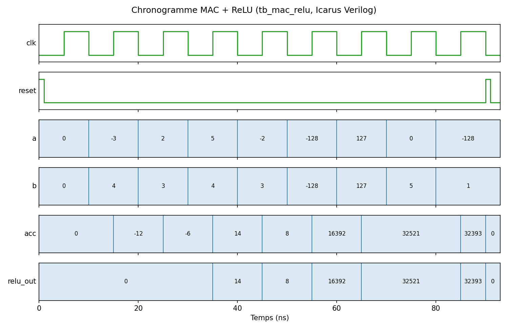

# MAC + ReLU accelerator (Verilog)

Multiply-accumulate unit with a ReLU activation, written in Verilog and verified
with Icarus Verilog, a NumPy reference model and cocotb.

## Design

`mac_relu.v` computes, on each rising clock edge:

```
produit   = a * b                 (signed 8 x 8 -> 16 bits)
acc       = acc + produit         (signed 32-bit accumulator)
relu_out  = max(0, acc)           (combinational)
```

| Port        | Direction | Width        | Description                       |
|-------------|-----------|--------------|-----------------------------------|
| `clk`       | input     | 1            | Clock, accumulator updates on rising edge |
| `reset`     | input     | 1            | Asynchronous reset of `acc` to 0  |
| `a`, `b`    | input     | 8 signed     | Operands                          |
| `acc`       | output    | 32 signed    | Accumulated value                 |
| `relu_out`  | output    | 32 signed    | ReLU of the accumulated value     |

## Project layout

| File | Role |
|------|------|
| `mac_relu.v` | Design under test |
| `tb_mac_relu.v` | Self-checking Verilog testbench (Icarus) |
| `vectors.py` | Shared input vectors and Python reference model |
| `reference.py` | Prints the reference table (NumPy) |
| `test_mac_relu.py` | cocotb tests: fixed vectors and 500 random cycles |
| `run_test.py` | Builds the design and runs the cocotb tests |
| `plot_waveform.py` | Draws the chronogram from the VCD file |
| `app/` | Interactive web interface (`server.py` + `static/`) |
| `docs/chronogramme.png` | Chronogram of the Verilog testbench run |
| `requirements.txt` | Python dependencies |

Test vectors (`A`, `B` in `vectors.py`) are duplicated in `tb_mac_relu.v`.
If you change one, change the other.

## Requirements

- Icarus Verilog 12 (`iverilog`, `vvp` on the PATH)
- Verilator 5 (for the lint step only)
- Python 3.12 or 3.13
- `pip install -r requirements.txt` (cocotb 2.1.0, numpy)

## Running the tests

Verilog testbench:

```powershell
iverilog -g2012 -s tb_mac_relu -o tb_mac_relu.vvp mac_relu.v tb_mac_relu.v
vvp tb_mac_relu.vvp
```

Expected last line: `RESULTAT : TOUS LES TESTS ONT REUSSI`

Verilator lint (design and testbench, all warnings enabled):

```powershell
verilator --lint-only -Wall --timing --top-module tb_mac_relu mac_relu.v tb_mac_relu.v
```

Expected: no warnings, exit code 0. On Windows, `pip install verilator` provides
the binary `verilator_bin.exe` (inside the installed `verilator` package folder,
with `VERILATOR_ROOT` set to that folder) in place of the `verilator` command.

Python reference model:

```powershell
python reference.py
```

cocotb tests (uses Icarus through cocotb):

```powershell
python run_test.py
```

Expected: `TESTS=2 PASS=2 FAIL=0`

To view waveforms, open `relu_simulation.vcd` in GTKWave, or draw the chronogram with the script:

```powershell
python plot_waveform.py
```

This writes `docs/chronogramme.png` from `relu_simulation.vcd` (run the Verilog testbench first).



## Interactive interface

A small local web app lets you type input pairs and watch the circuit work, cycle
by cycle. It runs the real `mac_relu.v` through Icarus Verilog and checks every
result against the Python model.

```powershell
python app/server.py
```

This opens http://127.0.0.1:8765 in your browser (add `--no-browser` to skip that,
`--port 9000` to change the port). Icarus Verilog must be installed
(`C:\iverilog\bin` is also searched if it is not on the PATH).

- Edit the (a, b) rows, or use "Exemple du rapport" / "Aléatoire". The simulation
  re-runs automatically.
- The "RAZ" box resets the accumulator before that cycle.
- Play, step with the arrow keys, or click the chronogram or a table row to move
  between cycles. The diagram shows the values flowing through the circuit.
- The status badge shows whether Verilog and Python agree.
- Add `?cycle=3` to the address to open the page directly on a given cycle.

The server only listens on `127.0.0.1` and uses nothing beyond the Python standard
library.

## Expected results

| Cycle | a    | b    | Product | ACC   | ReLU  |
|-------|------|------|---------|-------|-------|
| 1     | -3   | 4    | -12     | -12   | 0     |
| 2     | 2    | 3    | 6       | -6    | 0     |
| 3     | 5    | 4    | 20      | 14    | 14    |
| 4     | -2   | 3    | -6      | 8     | 8     |
| 5     | -128 | -128 | 16384   | 16392 | 16392 |
| 6     | 127  | 127  | 16129   | 32521 | 32521 |
| 7     | 0    | 5    | 0       | 32521 | 32521 |
| 8     | -128 | 1    | -128    | 32393 | 32393 |

The random test uses seed 2026, applies a reset at cycle 250 and checks every cycle.

## Limitations

- The accumulator is 32 bits and does not detect overflow. With 8-bit inputs it overflows after about 131 000 worst-case products (`(-128) x (-128) = 16384`).
- Reset is asynchronous in `mac_relu.v`. The random test also checks a reset in the middle of a run.
